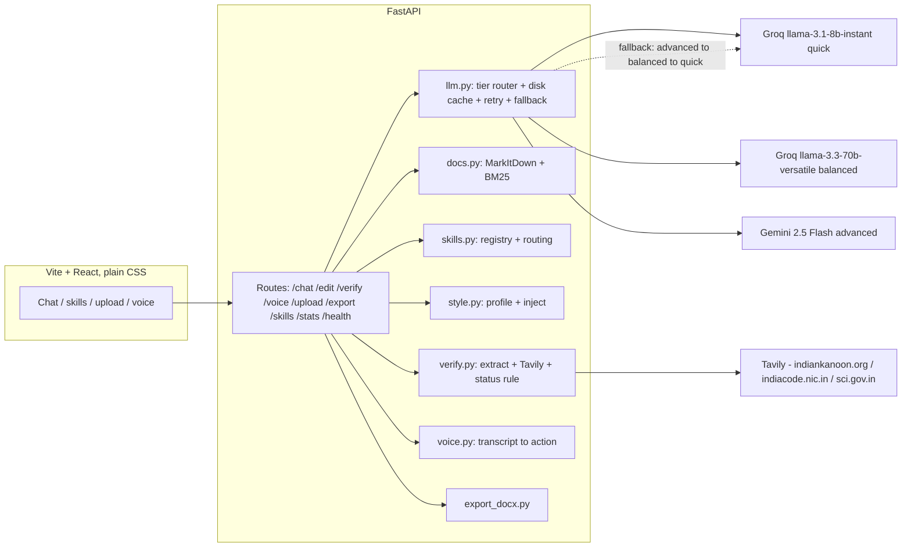

# Vidhi — DraftMate Legal Drafting Studio

Vidhi is an AI legal drafting studio for Indian law: upload a reference document, invoke drafting skills, generate drafts in the reference's style, verify citations against allow-listed legal sources, edit by voice or typed command, and export to DOCX.

> Live demo: local (deployment pending — see PROGRESS.md). Hosted on free tiers, so the first load may take about a minute to wake. Verification uses allow-listed legal sources and flags anything it can't confirm. Human review required.

## Setup

```
pip install -r requirements.txt
cd frontend && npm install
```

Copy `.env.example` to `.env` and fill in free-tier keys (never commit `.env`):

```
GEMINI_API_KEY=   # Google AI Studio
GROQ_API_KEY=     # Groq console
TAVILY_API_KEY=   # Tavily (1,000 credits/month free)
```

Check the three model tiers are alive:

```
python check_quota.py
```

## Run

Backend (port 8000):

```
python -m uvicorn main:app --port 8000
```

Frontend (port 5173):

```
cd frontend && npm run dev
```

Open http://localhost:5173.

## Demo flow (4 minutes)

1. Upload the reference NDA (`samples/reference_nda.docx`, reference toggle) → style profile and token meter appear.
2. `@legal_notice` + facts → draft in the reference's tone.
3. Verify: green/amber/red badges with source links; planted fake cases show red. "We flag instead of invent."
4. Voice: "make clause 3 shorter and more formal" → diff → Accept.
5. Voice: "delete the draft" → confirmation modal → "no".
6. Export DOCX.

## Architecture



Free-tier stack: Groq (quick/balanced), Google AI Studio Gemini (advanced/drafting default), Tavily search restricted to indiankanoon.org, indiacode.nic.in, sci.gov.in; MarkItDown + BM25 retrieval (no vector DB); browser Web Speech API for voice (typed command box always available); python-docx export.

Every LLM and Tavily call is disk-cached (`demo_cache/`), retried once on error, then falls down the tier chain (advanced → balanced → quick). If all tiers fail the API returns HTTP 429 with `retry_after` and the UI toasts and auto-retries once.

## Testing

```
python verify_test.py            # citation verification against test_citations.json
python smoke.py http://localhost:8000
python prewarm.py                # run the demo flow once to fill demo_cache
```

## Known limits

- Free-tier limits are approximate, were checked at T0, and can change.
- Groq 70B has a low daily token budget, so its outputs are capped and Gemini drafts.
- Verification confirms a source exists and matches the citation. It does not validate legal reasoning, and it covers only the allow-listed sites.
- Use sample or synthetic documents only; free-tier prompts may be used for model training.
- Deployed copy: cold start about a minute, uploads are session-only (ephemeral filesystem).
